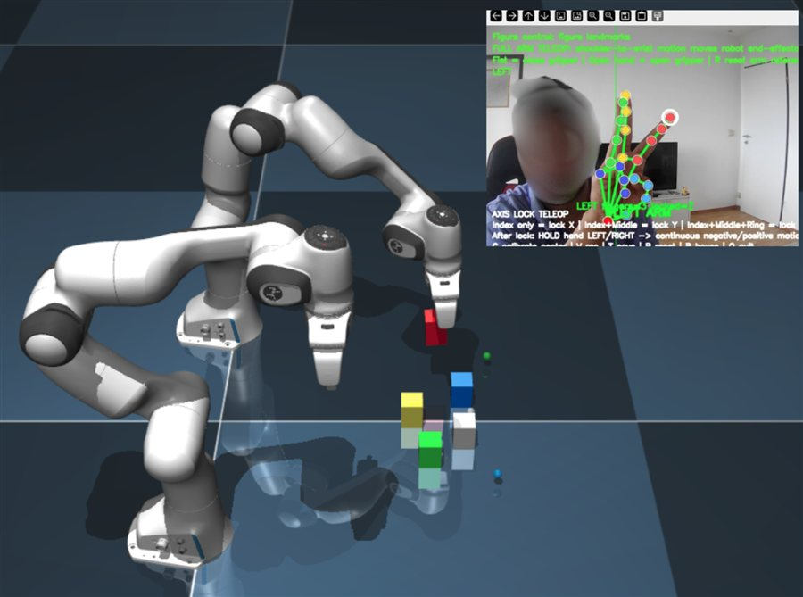

## Hi, I'm Tasfia Noor Chowdhury

I build **AI systems that learn from and help people**. My work spans three areas:

- **Robot learning from demonstration:** teaching manipulation and navigation skills from a handful of human demonstrations
- **Biomedical engineering:** wearable sensors, biosignal processing and assistive robotics
- **Machine learning and deep learning:** medical image analysis, diffusion models, computer vision and healthcare data

  
   
  Teaching a dual Franka Panda in MuJoCo with webcam hand gestures. One demonstration is expanded into 50 training episodes (IEEE RAAICON 2026).

### Currently

- 🔬 **Researching:** deep learning for knee abnormality detection from MRI (M.Sc. thesis, MAIM Lab, University of Dhaka)
- 🦾 **Building next:** a wearable IMU + EMG sleeve for gesture and fatigue recognition
- 📚 **Learning:** Diffusion Policy, ACT and LeRobot for real-robot imitation learning
- 🎓 **Seeking:** a fully funded PhD from 2027 in robot learning, human–robot interaction, wearable or biomedical AI, or medical robotics

### Background

- **M.Sc. in Robotics & Mechatronics Engineering**, University of Dhaka (2026–2027)
- **B.Sc. in Mechatronics & Industrial Engineering**, CUET, senior-year GPA 3.96/4.00, Dean's Award ×5

### Research

| Work | What it shows | Venue |
|---|---|---|
| **Hand-Gesture-Guided One-Demo-to-Many Robot Skill Generation with Teacher-Weighted Residual Correction in MuJoCo** | 1 webcam gesture demonstration becomes 50 physics-validated episodes. Behaviour cloning on geometry-preserving data reaches 98% / 96% held-out success, against 48% / 26% with naive noise. | IEEE RAAICON 2026 |
| **Human-Demonstration-Guided Warehouse Navigation with Safety-Aware Gap Reasoning for Mobile Robots** | TurtleBot3, ROS 2 Jazzy, Webots: a behaviour-cloned MLP with an interpretable safety layer. It cuts close-obstacle exposure from 65% to 2.4% of time, and recoveries by 40.8%. | IEEE RAAICON 2026 |
| [**Generative Traffic Forecasting: Preserving Shockwave Topology with Diffusion Models**](https://openreview.net/forum?id=KA5RdNascV) | Diffusion model (DDPM, conditional UNet1D) on PeMSD7 keeps the sharp shockwaves and phantom jams that MSE-trained forecasters smooth away; medoid MAE 5.32 mph. | ICML 2026 workshop (Forecast@ICML26), poster |
| [**Machine Learning Models for Optimizing Online Order Fulfillment**](https://doi.org/10.22034/ISS.2025.9373.1049) | XGBoost predicts late deliveries with F1 0.90 on 180k+ orders. | J. Optimization & Supply Chain Mgmt, 2025 |
| [**Hybrid Data-Driven Prediction of Inpatient Length of Stay**](https://arxiv.org/abs/2501.18535) (first author) | Spark on AWS, run over 2.3M hospital records, with ML, process mining and simulation. [Code](https://github.com/NoorTasfia/A-Hybrid-Data-Driven-Approach-For-Analyzing-And-Predicting-Inpatient-Length-Of-Stay-In-Health-Centre) | arXiv, 2025 |
| [**AI-Driven Water Segmentation for Flood Monitoring**](https://doi.org/10.48550/arXiv.2501.08266) | DeepLab v3 reaches 90.57% accuracy on a new augmented flood dataset. [Code](https://github.com/NoorTasfia/flood-segmentation) | arXiv, 2025 |

### Tools I use

  

**Robotics:** ROS 2 (Jazzy, Nav2), MuJoCo, Webots, Gazebo, Franka Panda, TurtleBot3, UR3
**ML:** Python, PyTorch, TensorFlow, scikit-learn, XGBoost, LightGBM, Apache Spark, AWS
**Automation:** Siemens TIA Portal, PLC (Ladder / FBD), Factory I/O, Arduino, SolidWorks

### Contact

[tasfiaa.chowdhury@gmail.com](mailto:tasfiaa.chowdhury@gmail.com) · [LinkedIn](https://www.linkedin.com/in/tasfia-noor-chowdhury/) · [ORCID](https://orcid.org/0009-0005-2074-1118) · [ResearchGate](https://www.researchgate.net/profile/Tasfia-Chowdhury) · [Website](https://sites.google.com/view/tasfia-noor/home)

### Contributions

<picture>
  <source media="(prefers-color-scheme: dark)" srcset="https://raw.githubusercontent.com/NoorTasfia/NoorTasfia/output/github-snake-dark.svg" />
  <source media="(prefers-color-scheme: light)" srcset="https://raw.githubusercontent.com/NoorTasfia/NoorTasfia/output/github-snake.svg" />
  
</picture>
